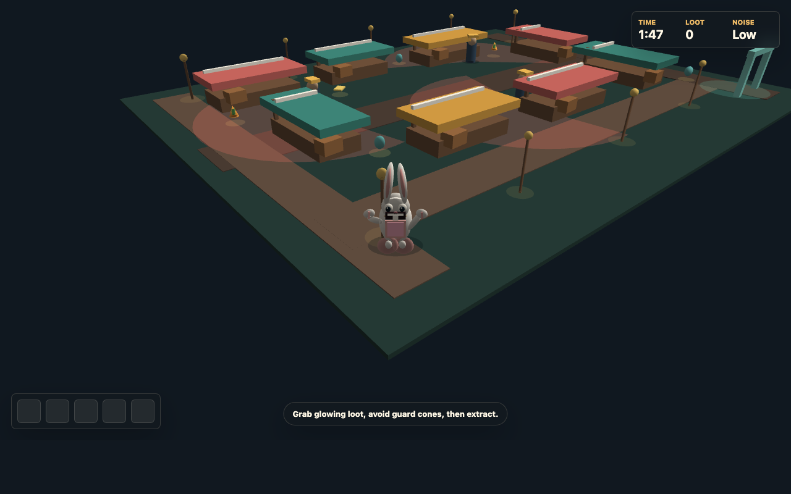
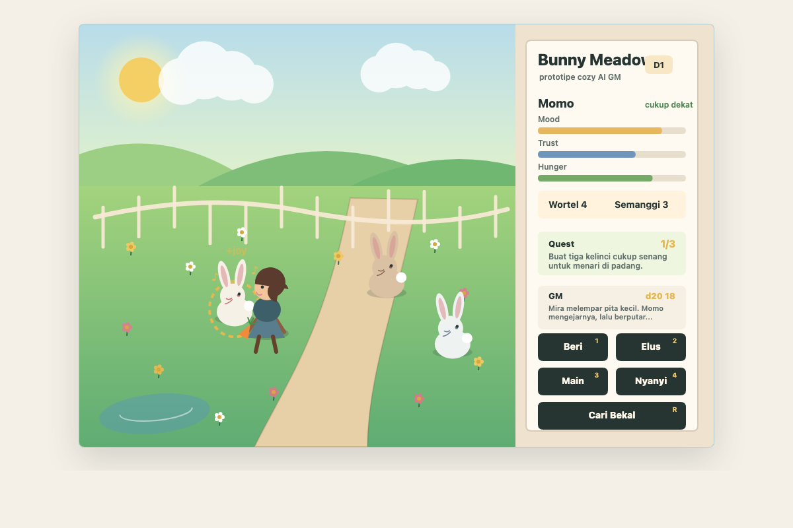

# Market Escape 3D

A browser-based stealth game set in a low-poly night market. Play as a rabbit, collect glowing loot, and reach the green exit gate before the two-minute timer runs out. Sprinting makes more noise, and hiding near a stall lets guards pass by.



## Play locally

From the project folder, start a local server with Python 3.

```sh
python3 -m http.server 5173 --bind 127.0.0.1
```

Open [localhost:5173](http://localhost:5173) in a browser with WebGL support. The game starts when the page loads.

## Controls

| Action | Input |
| --- | --- |
| Move | `WASD` or arrow keys |
| Sprint | Hold `Shift` while moving |
| Hide | Hold `Space` near a stall |
| Restart | `R` |

## Original 2D prototype

This project began as *Bunny Meadow GM*, a Canvas 2D prototype about Mira feeding and playing with rabbits. Its rule-based Game Master reacts to player actions. The main page launches the 3D night market, and the earlier source is available in [game.js](game.js).


